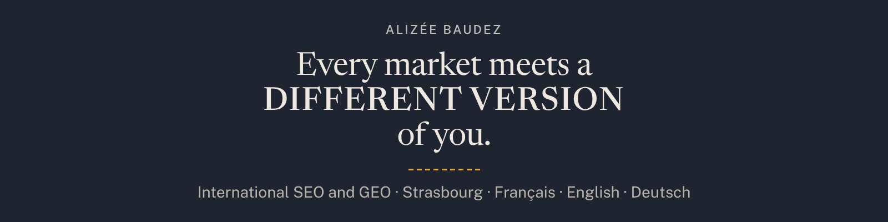

I'm Alizée, an international SEO and GEO consultant based in Strasbourg. I help companies that sell in several countries stay visible in each market and each language, in Google and in AI answers. I work in French, English and German.

I post on [LinkedIn](https://www.linkedin.com/in/alizeebaudez/) and write [Beyond Organic](https://alizeebaudez.com/newsletter), a newsletter on international SEO and AI search. I speak at search conferences, including Google Search Central Live Deep Dive in Barcelona this year, and teach SEO at EM Strasbourg, Université de Strasbourg and Epitech.

Off screen, I knit.

### What's here

- **[Cross-border AI visibility study](https://github.com/AlizeeBaudez/multi-market-ai-visibility-study)**: 1,944 tests on Google AI Overviews, ChatGPT and Perplexity, asked in three languages from France, Germany and Switzerland. [Read it online](https://alizeebaudez.github.io/multi-market-ai-visibility-study/).
- **[To-do bingo](https://github.com/AlizeeBaudez/todo-bingo)**: turns a to-do list into a bingo card.

### Elsewhere

[Website](https://alizeebaudez.com) · [LinkedIn](https://www.linkedin.com/in/alizeebaudez/) · [Newsletter](https://alizeebaudez.com/newsletter) · [Speaker Deck](https://speakerdeck.com/alizeebaudez) · [Gumroad](https://alizeebaudez.gumroad.com)
